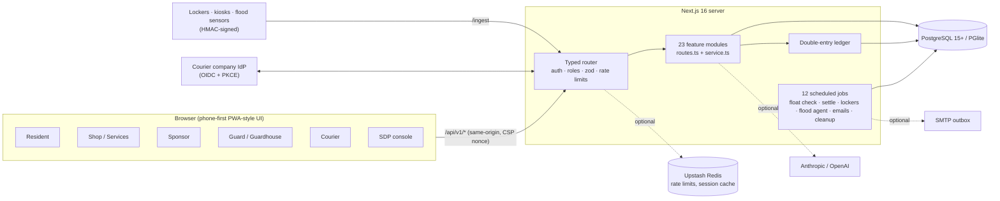

<div align="center">

# SimeTown — Township Super-App

**One web app for an entire township: residents, shops, home-service companies, sponsors, guards,
couriers and the property developer, on one shared, audited rewards ledger.**


Built for the **Sime Darby Property University Hackathon 2026** — *"Township of Tomorrow", People & Planet*.

[Live demo](https://simetown.onrender.com) · [Features by role](docs/FEATURES.md) · [Demo guide](docs/DEMO_TESTING.md) · [Architecture](docs/ARCHITECTURE.md) · [Security](docs/SECURITY.md) · [API](docs/API.md)

</div>

> **Student prototype.** Not an official Sime Darby Property product. Every resident, shop, sponsor,
> courier company and figure in the demo data is invented, and **no real money moves**.

---

## Why it exists

A modern township runs on a dozen disconnected tools: a visitor app at the gate, WhatsApp groups
for complaints, a paper logbook for parcels, a separate loyalty card at every shop, and nothing at
all for floods. SimeTown puts all of it behind **one sign-in, one points balance and one console**,
and ties it to a single rule:

> **No pool, no points.** A point exists only after a shop, a sponsor or the developer has paid for
> it. The reward float is reconciled against every point residents hold, to the sen, and that rule
> is enforced **inside PostgreSQL**, not just in the UI.

## At a glance

| | |
| --- | --- |
| **9 roles** | Resident · Shop / home-service business · Sponsor · Gate guard · Guardhouse parcel staff · Courier (and courier-company manager) · Township staff · Township admin · SDP HQ admin |
| **17 modules** | Points & XP, Kitar (recycling), Gerak (active mobility), Lapor (reporting), Komuniti, Banjir (flood), Akses+ (accessibility), Tamu (visitors), Parcels & smart lockers, Courier platform, SimeTown Home (home services), Merchant, Shop Offers, Partner Hub, Insights, AI Assistant, Incidents |
| **88 screens** | Every role has its own shell, phone-first navigation and walkthroughs |
| **434 API operations** | One typed route table, generated OpenAPI spec, CI fails if the docs drift |
| **52 SQL migrations** | Plain parameterised SQL, no ORM; double-entry ledger with database-level guards |
| **~520 test cases** | 39 Vitest suites, run on in-process PGlite **and** a real PostgreSQL 16 in CI, including concurrency tests |
| **2 languages** | Full English / Bahasa Malaysia; a test fails the build if any UI string lacks a Malay entry |

---

## Engineering highlights

**A money-grade ledger in the database.** Every point movement is a double-entry transaction
(`src/server/modules/ledger`). A `CHECK (balance >= 0)` makes overdrawing a pool impossible, a
deferred constraint trigger rejects any transaction that does not sum to zero at commit, and an
immutability trigger blocks `UPDATE`/`DELETE` on posted entries. A daily float check pauses
point movements if anything disagrees, and balance corrections need **two different admins**.

**One router, declared once.** Each endpoint declares its auth mode (public, session + roles,
cron token, sensor token or signed device), its zod schemas and its rate limit. A single catch-all
route hands every request to `src/server/http/router.ts`, which enforces all of it, maps Postgres
errors to clean API errors, and generates [docs/API.md](docs/API.md) and `openapi.json`.

**Security built in, not bolted on.**
- Salted scrypt passwords and SHA-256-hashed session tokens in `__Host-` cookies.
- Role-based idle timeouts: 15 min for staff, 30 min for others, none for guards on shift, a 12 h cap for everyone.
- An email alert whenever a password changes, with a link to reset it if the change was not the owner's.
- A per-request CSP nonce with `strict-dynamic`, and a same-origin check on every write.
- AES-256-GCM encryption for visitors' ID numbers, and HMAC-signed records from recycling machines and locker gateways.
- OpenID Connect (PKCE, RS256) sign-in for courier companies.
- Two-person approval for risky actions, an audit trail, PDPA data export and deletion, and scheduled retention deletes.

**An AI agent that cannot go rogue.** The resident Assistant (Anthropic or OpenAI, via plain
`fetch`) uses 9 tools over the resident's own data and checked township facts. It cites
sources, takes actions such as creating a visitor pass **only after the resident confirms**, can
never decide a flood alert, and falls back to deterministic rules when the AI is off, slow or over
its daily limit.

**Flood alerts with a second opinion.** The Banjir agent fuses water-level sensors, CCTV readings
(pluggable: your own CNN endpoint → hosted vision model → labelled test set), rain gauges and
resident reports. **Two independent signals must agree** before a warning goes out. A
one-signal draft waits for a duty officer, and a different staff member must confirm it.

**Hardware-ready, vendor-neutral.** Smart lockers, recycling kiosks and flood sensors run on
built-in simulators that use the **same signed contracts** real devices would. Nothing is mocked
in the business logic.

**Inclusive by default.**
- *Simple Mode* (four big buttons and step-by-step forms), an independent *Accessible view*, and read-aloud.
- Flash-and-vibrate alerts, carer links, and a priority help list for floods.
- 19 animated "See how it works" walkthroughs that respect `prefers-reduced-motion`.
- Layout-matched skeletons that show after 150 ms and stay at least 600 ms.

**Runs anywhere.**
- `npm run db:setup` works with zero installs, using in-process PostgreSQL (PGlite).
- For production: a multi-stage Docker image (non-root, health-checked), `docker compose` with PostgreSQL 16, and CI/CD that publishes to GHCR.
- Optional Upstash Redis for rate limits and the session cache, with automatic fallback to Postgres. Money never touches Redis.

---

## What each role can do

A short summary. **Every screen, tab and action is listed in [docs/FEATURES.md](docs/FEATURES.md).**

| Role | Highlights |
| --- | --- |
| **Resident** | Live *Today* card. Points & XP wallet with a member QR, badges and a street league. Recycle at smart kiosks, or book a home collection. GPS-tracked walking and cycling loops. Report problems with a photo and add *Me too* to existing ones. Neighbourhood events, help and lending. Flood status with *I'm safe / I need help*. Akses+ access needs and carers. Visitor passes. Private locker door and guardhouse parcels. Book vetted plumbers and air-con companies. Bilingual AI Assistant. |
| **Shop** | Counter: give points, accept points (the customer confirms on their own phone), apply a Shop Offer. Offers with budgets, days and hours. Sales with refunds. Weekly statements. Akses-friendly badge. |
| **Home-service company** | Booking inbox. Accept with a visit time and assign a registered worker, which issues an automatic gate pass. Mark arrived and done, then the resident confirms and reviews. Choose trades, with a licence check for licensed work. Manage workers. |
| **Sponsor** | Tier card with benefits and allowance. Funded campaigns with a budget split. Results shown only as grouped totals once a minimum group size is reached. |
| **Gate guard** | Scan visitor passes. Record visitor details (ID, transport, licence expiry, reason). Walk-ins with *Expected / Not expected / Call me*. SOS calls, patrol rounds, flood help tasks, and accessibility fixes for their team. |
| **Guardhouse staff** | Parcel counter: log parcels with a photo, confirm courier drop-offs, hand over against a one-time code. A searchable register with each parcel's history, call-due list and notes. |
| **Courier / manager** | Scan a label and the courier company confirms the shipment. The recipient is matched and masked. A private locker door opens, with a fallback to the guardhouse. Managers add, suspend and reconfirm their own couriers. Couriers can also sign in through their company's own sign-in (OIDC). |
| **Township staff** | Insights, the Lapor queue, the incident case board with deadlines, the parcel operations centre, the flood agent queue and sensors, kiosks, loops, recycling collections, access places, Komuniti moderation, campaigns, and resident verification. |
| **Township admin** | Everything staff do, plus approving shops, licences and courier companies, float checks, settlements and two-person corrections, the locker policy, case assignment, and the audit trail. |
| **SDP HQ admin** | Every township, plus programme rules, sponsor tier payments, and creating admin and sponsor accounts. |

---

## Quick start (5 minutes)

You need **Node.js 22.23.4+ (or 24.22.1+)**. Nothing else: the default database is an in-process
PostgreSQL (PGlite).

```bash
git clone https://github.com/nurinirdnz/SimeTown.git
cd SimeTown
npm install
cp .env.example .env          # the defaults work as they are
npm run db:setup              # creates the tables and the demo township
npm run dev                   # open http://localhost:3000
```

`db:setup` prints the demo accounts and **the password it generated for them**. To choose the
password yourself, set `SEED_DEMO_PASSWORD` in `.env` (10+ characters) before running it.

- Open the app at exactly `APP_URL` (`http://localhost:3000`, not `127.0.0.1`). Other origins are refused on purpose.
- With PGlite, stop `npm run dev` before running `db:*` or `job` scripts (only one process can open it).
- To start again from nothing, delete the `.data` folder and run `npm run db:setup`.
- For a shared demo, set `DATABASE_URL=postgres://…` (PostgreSQL 15+) or use Docker: see [docs/DEPLOYMENT.md](docs/DEPLOYMENT.md).

Optional switches in `.env`:

| Setting | What it turns on |
| --- | --- |
| `AI_PROVIDER`, `AI_API_KEY`, `AI_MODEL` | The hosted AI Assistant and photo and report classification |
| `SMTP_*` | Real emails: welcome, password reset, password changed, parcel and visitor notices. If your host blocks ports 465 and 587, as Render's free plan does, use a mail provider on port 2525 |
| `UPSTASH_REDIS_REST_URL` / `_TOKEN` | Redis rate limits and the session cache |
| `NEXT_PUBLIC_GOOGLE_MAPS_API_KEY` | A Google basemap for Gerak, instead of the built-in township map |
| `FLOOD_MODEL_URL` | Your own CCTV water-level model |

---

## Demo accounts

Every account uses the **same password** printed by `db:setup` (or your `SEED_DEMO_PASSWORD`).
Every email ends in **`@demo.kita.test`**.

| Role | Sign in as | Who / what you'll see |
| --- | --- | --- |
| Resident (main demo) | `aisyah` | Aisyah Rahman, owner of No. 1 Jalan Metafasa U16/171 (Elmina Valley 1). Every resident feature has data |
| Resident | `daniel` | Daniel Tan, a neighbour: a walk-in visitor is waiting at the gate for his answer |
| Resident (Simple Mode) | `zainab` | Zainab Yusof: Simple Mode, on the flood priority help list, with Mei Ling as her carer |
| Resident (carer) | `meiling` | Lim Mei Ling: cares for Zainab in Akses+ |
| Residents (neighbours) | `priya`, `hafiz`, `siti`, `arjun`, `karyan` | Neighbours with reports, *Me too*s, parcels and Komuniti posts |
| Residents (Elmina West) | `izzah`, `rajesh` | Flat owners in Pangsapuri Harmoni Elmina, served by Locker C |
| Resident (tenant, pending) | `imran` | Imran Hakim: a tenant of Aisyah's home, waiting for her to confirm him |
| Resident (not yet confirmed) | `grace` | Grace Chong: waiting for the township office, and asked to add a phone number |
| Shop | `kafe`, `kedai` | Kafe Seri Pagi and Kedai Runcit Mesra: counter, Shop Offers, sales, statements |
| Shop (not approved) | `bengkel` | Bengkel Basikal Roda: the "waiting for approval" state |
| Home services | `plumber` | Elmina Plumbing Co. (workers Ahmad and Lim), with an electrical licence check waiting |
| Home services | `aircon` | Sejuk Aircon Services |
| Shop **and** home services | `kemas` | Kemas Home Care: both menus on one business account |
| Sponsor | `sponsor` | Solar Cerah: Green Champion tier, campaigns and grouped results |
| Gate guard | `guard` | Azman Shah: visitor passes, walk-ins, SOS, patrol, flood duty |
| Guardhouse staff | `guardhouse` | Nur Aina: guardhouse parcel counter and register |
| Courier (J&T, simulated) | `courier`, `hairul` | Faizal Rahman and Hairul Azman: barcode-checked locker deliveries |
| Courier (Ninja Van, simulated) | `nurul` | Nurul Ain: medium-assurance shipments, company outage fallback |
| Courier (Pos Laju) | `poslaju` | Rahim Osman: a township-approved courier for every locker bank |
| Courier (suspended) | `courier2` | Ahmad Zaki: suspended by Ninja Van, cannot deliver |
| Courier-company manager | `jnt-manager`, `ninjavan-manager` | Kavitha Raman (J&T) and Tan Wei Ming (Ninja Van): manage their own couriers |
| Courier via company sign-in | staff no. `SPX-3001` | Lim Wei Jie, Shopee Express: *Sign in with your courier company* on the sign-in page (`SPX-3002` is refused by the company) |
| Township staff | `staff`, `staff2` | Ravi Kumar and Mei Chen: work cases, hand them between each other |
| Township admin | `admin`, `admin2` | Nurul Huda and Jason Lee: approvals, money and the second-approver flows |
| SDP HQ admin | `hq` | Farah Aziz: every township and the programme rules |

➡️ **A guided 30-minute demo script, and what to try with each account, is in
[docs/DEMO_TESTING.md](docs/DEMO_TESTING.md).**

---

## Architecture



```
src/
  app/                 88 screens (App Router) + one API entry point (api/v1/[...path])
    app/ merchant/ sponsor/ guard/ guardhouse/ courier/ console/   one area per role
  components/ui/       the design system: buttons, fields, dialogs, tables, charts, skeletons
  components/features/ shared feature pieces, walkthroughs, maps, scanners
  server/              the backend; never imports from app/ or components/
    http/              router, OpenAPI, uploads, pagination
    modules/<feature>/ routes.ts (who may call what) + service.ts (rules and SQL)
    db/migrations/     52 SQL migrations
  shared/              domain words both sides use: roles, categories, session rules
scripts/               migrate, seed, bootstrap, jobs, API docs, i18n audit
tests/                 39 suites: one test per business rule, API, concurrency, i18n
docs/                  architecture, business rules, security, deployment, API, demo guide
```

To follow one feature end to end, open `src/server/modules/<feature>/routes.ts`, then its
`service.ts`, then the screen under `src/app`.

---

## Commands

| Command | What it does |
| --- | --- |
| `npm run dev` | Development server |
| `npm run build` / `npm start` | Production build and server |
| `npm test` | The full test suite on in-process PostgreSQL |
| `TEST_DATABASE_URL=postgres://… npm test` | The same tests on a real server (this **empties that database**) |
| `npm run check` | Lint + type-check + tests |
| `npm run db:migrate` / `db:seed` / `db:setup` | Apply migrations / load the demo township (refused in production) / both |
| `npm run bootstrap -- <file.json>` | Set up a real township: zones, homes and the first admin's invitation (see `docs/bootstrap.example.json`) |
| `npm run job -- <name>` | Run a job once: `expire-points`, `float-check`, `settle`, `cleanup`, `flood-agent`, `parcel-reminders`, `lockers`, `couriers`, `incidents`, `access`, `recycling`, `emails` |
| `npm run docs:api` | Regenerate `docs/API.md` and `docs/openapi.json` |
| `npm run i18n:audit` | List any interface text without a Malay translation |

---

## Documentation

| Doc | What's inside |
| --- | --- |
| [FEATURES.md](docs/FEATURES.md) | Every feature, screen and action, role by role |
| [DEMO_TESTING.md](docs/DEMO_TESTING.md) | Demo accounts, a guided demo script and flows that cross accounts |
| [ARCHITECTURE.md](docs/ARCHITECTURE.md) | Design decisions, database, ledger, lockers, incidents, design and motion systems |
| [BUSINESS_RULES.md](docs/BUSINESS_RULES.md) | Each business rule, where it is enforced and which test proves it |
| [SECURITY.md](docs/SECURITY.md) | Threats, controls and known limits |
| [DEPLOYMENT.md](docs/DEPLOYMENT.md) | Environments, Docker, Cloudflare, scheduled jobs, hardware contracts |
| [API.md](docs/API.md) | All 434 operations (also served at `/api/v1/openapi.json`) |
| [NOTIFICATIONS.md](docs/NOTIFICATIONS.md) · [EMAIL_DESIGN.md](docs/EMAIL_DESIGN.md) · [LANGUAGES.md](docs/LANGUAGES.md) | Notifications and deep links, transactional email, English/Malay |
| [RISK_REGISTER.md](docs/RISK_REGISTER.md) | Courier-platform risks and mitigations |
| [SimeTown-UI-UX-GUIDELINES.md](docs/SimeTown-UI-UX-GUIDELINES.md) · [CONSOLE_UI_HANDOVER.md](docs/CONSOLE_UI_HANDOVER.md) | UI, motion and skeleton standards |
| [CONTRIBUTIONS.md](docs/CONTRIBUTIONS.md) | Nurin Irdina's contributions, from the git history |

---

## Honest status

- **Simulated, and labelled so in the app:**
  - Money (deposits and settlements are ledger entries recorded by an admin).
  - The courier companies J&T Express, Ninja Van and Shopee Express, and their tracking numbers.
  - Smart-locker hardware, the recycling-machine sensors, and the flood sensors, CCTV and rain gauge.
  - SMS. Gerak route playback in test mode.
- **Previews:** home warranty and defect records, resale and rental listings.
- **Archived for now, with restore kits:** guided parking, Jimat energy bills and solar sites, and greener building materials ([docs/archive/](docs/archive/)).
- **Hosted demo:** runs at [simetown.onrender.com](https://simetown.onrender.com), with Render for the app, Supabase for PostgreSQL and Brevo for email.
  - On a free plan the site sleeps when idle, so the first visit can take about a minute.
  - A daily GitHub Action calls the readiness check to help stop the database pausing.
  - The repo includes no scheduler for the other background jobs, so parcel and visitor emails and reminders only go out where one is set up.
- **Not yet done:**
  - No penetration test, load test or real-phone testing.
  - The live AI call has not been exercised without a key (its fallbacks are tested).
  - Rates such as 1 point per RM1 are the proposal's assumptions.
  - See [SECURITY.md › Known limits](docs/SECURITY.md#known-limits).

---

## Team

Built by a student team for the Sime Darby Property University Hackathon 2026:

- **Nurin Irdina** — [@nurinirdnz](https://github.com/nurinirdnz) · [contributions](docs/CONTRIBUTIONS.md)
- **Nur Amira Izreena Azlan** — [@AmiraIzreena](https://github.com/AmiraIzreena)
- **Syafiqah Wahidah** — [@syafiqahwahidah](https://github.com/syafiqahwahidah)
- **Isabela Nur Sofea** — [@isabelanursofea](https://github.com/isabelanursofea)
- **Christiano Claudio Christopher** — [@CTeno24](https://github.com/CTeno24)
